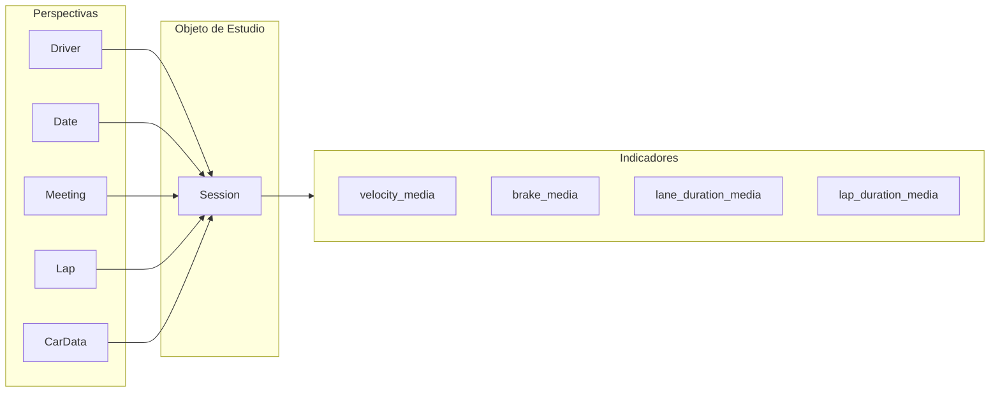
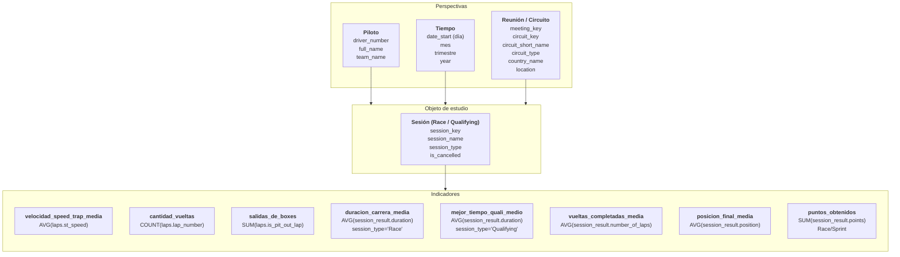
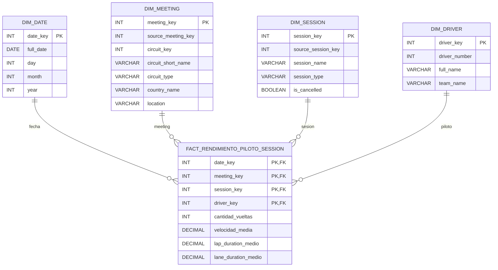
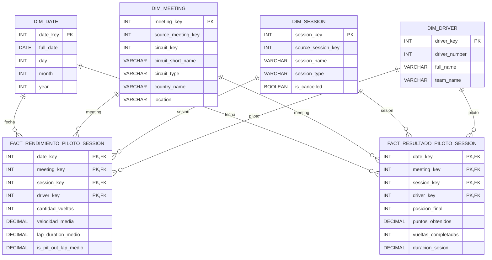

# Presentación del tema y la fuente de datos

[Fuente de Datos](https://openf1.org/docs/?python#api-endpoints) 

> Fecha de descarga: 09/09/2026

## Información
**La base de datos es sobre la fórmula 1. La información que trae es acerca de las carreras, detalles del auto (aceleración, frenado, velocidad, etc), información de los pilotos, clima ocurrido en las carreras, etc..**
- Car data
- Stints
- Laps
- Starting Grid
- Sessions result
- Drivers
- Meetings
- Sessions
- Race Control
- Weather

## Objetivos del DW
- ¿Qué implicancia tiene cada variable (Stint, Weather, Starting Grid) respecto a las posiciones finales de los pilotos?
- ¿Cómo impacta cada variable en el desarrollo de cada carrera? Por ejemplo, ¿Cómo impacta el clima en la carrera? ¿Aumentan el número de choques? ¿Aumenta el tiempo de finalización promedio de cada carrera? ¿El tiempo promedio de frenado aumenta cuando hay lluvia? 
- ¿Existe alguna relación entre cada circuito y el desempeño del piloto? ¿El piloto se comporta diferente según cada circuito (acelera mas , frena mas , gasta mas gomas, tiene velocidad promedio mayor o menor, etc)
- ¿El tiempo en pits de cada piloto afecta al desempeño del piloto en la carrera? 
- ¿Cuál es la relación de las rpm del motor del auto respecto a cada circuito y lo que implica en el desempeño del piloto?
- ¿Existe alguna relación entre el gasto de las gomas y el circuito? ¿En algunos circuitos se consumen más gomas que en otros?
- ¿Existe alguna relación entre el estado emocional del piloto y su desempeño en la carrera y/o temporada? (pe en race control , hay una columna message que describe el evento o acciones)

## Identificar indicadores y perspectivas
- Date 
- Clima 
- Circuito  
- Velocidad promedio por piloto en cada circuito
- RPM promedio por piloto en cada circuito
- Tiempo frenando promedio por piloto en cada circuito

##  Modelo Conceptual



# 2. Consigna: Análisis de la fuente de datos (HEFESTO)

**Fuente:** OpenF1 — <https://openf1.org/docs/#api-endpoints>
**Fecha de descarga:** 09/09/2026
**Alcance de este paso:** los endpoints `meetings`, `sessions`, `drivers`, `laps` y `session_result` (sesiones de tipo *Race* y *Qualifying*). Se descarta `car_data` por el volumen y la complejidad de recuperarla vía consultas (una consulta por piloto y sesión, con telemetría de alta frecuencia y ruido).

---

## 2.1. Perfil del archivo

La fuente es una API REST que devuelve datos de Fórmula 1 en formato JSON/CSV. Cada endpoint funciona como una tabla. Las tablas se relacionan por `meeting_key` (fin de semana de Gran Premio), `session_key` (sesión dentro del fin de semana) y `driver_number` (número del piloto).

**Convención de relación:**
<br>`meeting` 1—N `session`
<br>`session` 1—N (`driver`, `lap`, `session_result`)

> Nota: `driver_number` es único solo dentro de una temporada, por lo que la `clave primaria` de un piloto en una sesión es `compuesta`, es decir, es la combinación `(session_key, driver_number)`.

### 2.1.1 Meetings (reuniones / fines de semana de Gran Premio)

Una *meeting* (reunión) es un Gran Premio o un fin de semana de test, y generalmente incluye varias sesiones (práctica, clasificación, carrera, etc.). Se actualiza todos los días a las 00:00 UTC.
Endpoint: <https://api.openf1.org/v1/meetings>

| Columna | Descripción | Tipo dato |
|---|---|---|
| `circuit_key` | Identificador único del circuito donde se realiza el evento | Int (clave) |
| `circuit_info_url` | URL a un JSON con información detallada del circuito (dato de MultiViewer) | Texto (URL) |
| `circuit_image` | Imagen del circuito | Texto (URL) |
| `circuit_short_name` | Nombre corto o común del circuito | Texto |
| `circuit_type` | Tipo de circuito (`Permanent`, `Temporary - Street`, `Temporary - Road`) | Texto (categoría) |
| `country_code` | Código que identifica al país | Texto (categoría) |
| `country_flag` | Imagen de la bandera del país | Texto (URL) |
| `country_key` | Identificador único del país donde se realiza el evento | Número (clave) |
| `country_name` | Nombre completo del país | Texto (categoría) |
| `date_end` | Fecha y hora UTC de finalización (ISO 8601) | Fecha-hora |
| `date_start` | Fecha y hora UTC de inicio (ISO 8601) | Fecha-hora |
| `gmt_offset` | Diferencia (horas y minutos) entre la hora local del evento y GMT | Texto/intervalo |
| `is_cancelled` | Indica si la meeting fue cancelada | Booleano |
| `location` | Ciudad o ubicación geográfica del evento | Texto |
| `meeting_key` | Identificador único de la reunión (`latest` = la más reciente) | Número (clave) |
| `meeting_name` | Nombre de la reunión (por ejemplo, "Singapore Grand Prix") | Texto |
| `meeting_official_name` | Nombre oficial completo de la reunión | Texto |
| `year` | Año en que se realiza el evento | Número |

> `meetings` es el punto de partida del proceso de extracción: primero se filtran las reuniones de interés, y a partir de su `meeting_key` se recuperan las sesiones asociadas en `sessions`.

### 2.1.2 Sessions (sesiones)

Una sesión es un período diferenciado de actividad en pista durante un Gran Premio o un fin de semana de test (práctica, clasificación, sprint, carrera, etc.).
Endpoint: <https://api.openf1.org/v1/sessions>

| Columna | Descripción | Tipo aparente |
|---|---|---|
| `circuit_key` | Identificador único del circuito donde se realiza el evento | Número (clave) |
| `circuit_short_name` | Nombre corto o común del circuito | Texto |
| `country_code` | Código que identifica al país | Texto (categoría) |
| `country_key` | Identificador único del país donde se realiza el evento | Número (clave) |
| `country_name` | Nombre completo del país | Texto (categoría) |
| `date_end` | Fecha y hora UTC de finalización (ISO 8601) | Fecha-hora |
| `date_start` | Fecha y hora UTC de inicio (ISO 8601) | Fecha-hora |
| `gmt_offset` | Diferencia (horas y minutos) entre la hora local del evento y GMT | Texto/intervalo |
| `is_cancelled` | Indica si la sesión fue cancelada | Booleano |
| `location` | Ciudad o ubicación geográfica del evento | Texto |
| `meeting_key` | Identificador único de la reunión (`latest` = la más reciente) | Número (clave) |
| `session_key` | Identificador único de la sesión (`latest` = la más reciente) | Número (clave) |
| `session_name` | Nombre de la sesión (Practice 1, Qualifying, Race, ...) | Texto (categoría) |
| `session_type` | Tipo de sesión (Practice, Qualifying, Race, ...) | Texto (categoría) |
| `year` | Año en que se realiza el evento | Número |

### 2.1.3 Drivers (pilotos)

Información detallada de los pilotos que participan en una sesión específica.
Endpoint: <https://api.openf1.org/v1/drivers>

| Columna | Descripción | Tipo aparente |
|---|---|---|
| `broadcast_name` | Nombre del piloto tal como se muestra en TV | Texto |
| `country_code` (obsoleta) | Código de país. Se eliminará al final de la temporada 2026 | Texto |
| `driver_number` | Número único asignado al piloto durante la temporada | Número |
| `first_name` | Nombre de pila | Texto |
| `full_name` | Nombre completo | Texto |
| `headshot_url` | URL de la foto del rostro del piloto | Texto (URL) |
| `last_name` | Apellido | Texto |
| `meeting_key` | Identificador de la reunión | Número (clave) |
| `name_acronym` | Acrónimo de tres letras del nombre del piloto | Texto (categoría) |
| `session_key` | Identificador de la sesión | Número (clave) |
| `team_colour` | Color hexadecimal (RRGGBB) del equipo | Texto |
| `team_name` | Nombre del equipo del piloto | Texto (categoría) |

###  2.1.4 Laps (vueltas)

Información detallada de cada vuelta individual.
Endpoint: <https://api.openf1.org/v1/laps>

| Columna | Descripción | Tipo aparente |
|---|---|---|
| `date_start` | Fecha y hora UTC de inicio de la vuelta (aproximada) | Fecha-hora |
| `driver_number` | Número del piloto | Número |
| `duration_sector_1` | Tiempo (s) en completar el sector 1 | Número (segundos) |
| `duration_sector_2` | Tiempo (s) en completar el sector 2 | Número (segundos) |
| `duration_sector_3` | Tiempo (s) en completar el sector 3 | Número (segundos) |
| `i1_speed` | Velocidad (km/h) en el primer punto intermedio de la pista | Número (km/h) |
| `i2_speed` | Velocidad (km/h) en el segundo punto intermedio | Número (km/h) |
| `is_pit_out_lap` | Indica si es una vuelta de salida de boxes (*out lap*) | Booleano |
| `lap_duration` | Tiempo total (s) de la vuelta | Número (segundos) |
| `lap_number` | Número secuencial de la vuelta dentro de la sesión (desde 1) | Número |
| `meeting_key` | Identificador de la reunión | Número (clave) |
| `segments_sector_1` | Lista de valores de los "mini-sectores" del sector 1 | Lista de códigos |
| `segments_sector_2` | Ídem, sector 2 | Lista de códigos |
| `segments_sector_3` | Ídem, sector 3 | Lista de códigos |
| `session_key` | Identificador de la sesión | Número (clave) |
| `st_speed` | Velocidad (km/h) en la *speed trap* (punto de la pista donde suelen registrarse las velocidades máximas) | Número (km/h) |

### 2.1.5 Session Result (resultado de sesión)

Clasificación al finalizar una sesión. Los datos están disponibles unos minutos después de publicados los resultados oficiales en el sitio de la F1.
Endpoint: <https://api.openf1.org/v1/session_result>

| Columna | Descripción | Tipo aparente |
|---|---|---|
| `dnf` | El piloto no terminó (*Did Not Finish*). Solo puede ser verdadero en clasificación y carrera | Booleano |
| `dns` | El piloto no largó (*Did Not Start*). Solo en clasificación y carrera | Booleano |
| `dsq` | El piloto fue descalificado | Booleano |
| `driver_number` | Número del piloto | Número |
| `duration` | Mejor vuelta (práctica/clasificación) o tiempo total de carrera (carreras), en segundos. **En clasificación es un arreglo de 3 valores** (Q1, Q2, Q3), con `null` en las fases no alcanzadas | Número, o arreglo de 3 (quali) |
| `gap_to_leader` | Diferencia (s) con el líder de esa sesión/fase, o el texto `+N LAP(S)` si el piloto fue doblado. **En clasificación es un arreglo de 3 valores** | Número/texto, o arreglo de 3 (quali) |
| `number_of_laps` | Total de vueltas completadas en la sesión | Número |
| `meeting_key` | Identificador de la reunión | Número (clave) |
| `points` | Puntos obtenidos en la sesión. Solo presente en *Race* y *Sprint*; ausente en `session_result` de clasificación | Número |
| `position` | Posición final del piloto al terminar la sesión. `null` si `dnf`/`dns`/`dsq` | Número |
| `session_key` | Identificador de la sesión | Número (clave) |

> **Verificado con datos reales:** en una carrera, un piloto doblado (`gap_to_leader = "+1 LAP"`) tiene `duration = null` aunque `dnf = false`. Es decir, `duration` puede ser nulo sin que ninguna de las tres banderas (`dnf`, `dns`, `dsq`) lo indique. Por eso los indicadores basados en `duration` deben filtrar por `duration IS NOT NULL` y no solo por esas banderas (ver sección 2).

---

## 2.2. Conformación de indicadores

**Granularidad del hecho:** un registro por `piloto × sesión` para sesiones de tipo `Race y Qualifying`. La tabla `laps` tiene un nivel de detalle más fino (una fila por vuelta), por lo que se agrega hasta el nivel piloto × sesión antes de cargarla al DW.

### Tratamiento de los campos `duration` y `gap_to_leader` en Qualifying

En clasificación, `duration` y `gap_to_leader` llegan como **arreglos de 3 posiciones** (Q1, Q2, Q3), con `null` en las fases que el piloto no alcanzó (por ejemplo, un piloto eliminado en Q1 tiene `duration = [93.469, null, null]`).

### 2.2.1. Indicadores

| Indicador | Fórmula | Agregación | Tabla de origen |
|---|---|---|---|
| Velocidad media en speed trap | `st_speed` | `AVG` | laps |
| Duración media de vuelta | `lap_duration` (excluyendo out laps y nulos) | `AVG` | laps |
| Cantidad de vueltas registradas | `lap_number` | `COUNT` | laps |
Velocidad media en punto intermedio 1 | `i1_speed` | `AVG` | laps |
| Velocidad media en punto intermedio 2 | `i2_speed` | `AVG` | laps |
| Cantidad de salidas de boxes (proxy de paradas) | `is_pit_out_lap` | `SUM` | laps |
| Duración media de carrera | `duration`, filtrado por `session_type = 'Race'` y `duration IS NOT NULL` | `AVG` | session_result |
| Mejor tiempo medio de clasificación | `duration` (última fase alcanzada), filtrado por `session_type = 'Qualifying'` y `duration IS NOT NULL` | `AVG` | session_result |
| Diferencia media con el líder | `gap_to_leader` (numérico; excluye `+N LAP(S)`), por tipo de sesión | `AVG` | session_result |
| Vueltas completadas (media) | `number_of_laps` | `AVG` | session_result |
| Posición final media | `position` (excluye `dnf`/`dns`/`dsq`, ya vienen como `null`), por tipo de sesión | `AVG` | session_result |
| Puntos obtenidos | `points`, solo `session_type IN ('Race', 'Sprint')` | `SUM` / `AVG` | session_result |

### 2.2.2. Aclaraciones de cálculo: 
- `SUM(is_pit_out_lap)` (booleano → 0/1) reemplaza al `COUNT` que contaba todas las filas no nulas en lugar de solo las verdaderas.
- Los indicadores de `session_result` que comparan Race y Qualifying (posición, gap, duración) deben calcularse **por separado según `session_type`**, o incluir `session_type` como columna de agrupamiento: los valores no son comparables entre sí (el "líder" de Q1 no es el mismo concepto que el líder de la carrera).
- `points` no existe en los registros de `session_result` de clasificación — al unificar Race y Qualifying en una sola tabla de hechos, esa columna queda `null` para las filas de Qualifying (no es un error, es esperado).

---

## 2.3. Correspondencias

### 2.3.1 Perspectivas

| Perspectiva | Columnas de origen |
|---|---|
| Tiempo | `sessions.date_start` (día, mes, trimestre, año), `sessions.year` |
| Reunión / Circuito | `meetings.meeting_key`, `circuit_key`, `circuit_short_name`, `circuit_type`, `country_name`, `location` |
| Sesión (objeto de estudio) | `sessions.session_key`, `session_name`, `session_type`, `is_cancelled` |
| Piloto | `drivers.driver_number`, `full_name`, `team_name` |
| Clima | 
 

### 2.3.2 Indicadores

| Perspectiva / Tabla | Columna | Indicador |
|---|---|---|
| Laps | `AVG(st_speed)` | Velocidad media en speed trap |
| Laps | `COUNT(lap_number)` | Cantidad de vueltas registradas |
| Laps | `SUM(is_pit_out_lap)` | Cantidad de salidas de boxes |
| Session Result (Race) | `AVG(duration)` | Duración media de carrera |
| Session Result (Qualifying) | `AVG(duration)` | Mejor tiempo medio de clasificación |
| Session Result | `AVG(number_of_laps)` | Vueltas completadas (media) |
| Session Result | `AVG(position)` | Posición final media |
| Session Result (Race/Sprint) | `SUM(points)` / `AVG(points)` | Puntos obtenidos |

---

## 2.4. Nivel de granularidad

### 2.4.1 Perspectiva Tiempo

- **Origen:** `sessions.date_start` (UTC). Para el día calendario local se puede sumar `gmt_offset`.
- **Jerarquía:** día → mes → trimestre → año.
- **Nivel de agrupamiento elegido: día.** Es el nivel más atomico, porque cada sesión ocurre en un día concreto y dentro de un fin de semana solo hay una carrera por día. Desde ahí se puede subir a mes, trimestre y año para comparar temporadas.
- Se descarta la hora: la hora de inicio no aporta al análisis.

### 2.4.2 Columnas por perspectiva

#### **Reunión / Circuito** (`meetings`)

| Columna | Motivo |
|---|---|
| `meeting_key` | Clave natural de la reunión |
| `circuit_key` | Clave estable del circuito; permite comparar el mismo circuito entre años, incluso si cambia de nombre |
| `circuit_short_name` | Etiqueta legible del circuito para reportes |
| `circuit_type` | Permite distinguir circuitos urbanos ("Temporary - Street") de permanentes; relevante para las preguntas de negocio sobre el desempeño según el circuito |
| `country_name` | Nivel superior de la jerarquía (circuito → país) |
| `location` | Ciudad; complementa al circuito |

------------
------------

#### **Sesión** (`sessions`)

| Columna | Motivo |
|---|---|
| `session_key` | Clave natural de la sesión |
| `session_name` | Distingue Race / Sprint / Qualifying / Practice |
| `session_type` | Agrupa las sesiones en categorías |
| `is_cancelled` | Permite excluir sesiones canceladas |
| `date_start` | Alimenta la perspectiva Tiempo |
| `date_end` | Sirve solo para calcular la duración total de la sesión, no se usa como perspectiva |
| `year` | Nivel año de la perspectiva Tiempo |
------
------

#### **Piloto** (`drivers`)

| Columna | Motivo |
|---|---|
| `driver_number` | Se combina con `session_key` para identificar al piloto en una sesión |
| `full_name` | Etiqueta legible. Es la mejor candidata a identificar al piloto entre temporadas |
| `team_name` | Permite analizar por equipo (nivel superior de la jerarquía piloto → equipo) |

### 2.4.3 Consistencia de los valores de texto

Estas son las inconsistencias que **hay que verificar** al cargar los datos en Jupyter (marcadas como esperadas por la naturaleza de la fuente; confirmar cuáles aparecen realmente en el archivo descargado):

| Campo | Posible problema | Resolución propuesta |
|---|---|---|
| `team_name` | Un mismo equipo puede cambiar de nombre entre temporadas (renombres de marca) o aparecer con variantes de mayúsculas/espacios | Normalizar (`strip`, minúsculas) y armar un mapeo manual `nombre_original → equipo_canónico` |
| `full_name` | Diferencias de mayúsculas (por ejemplo, apellido en mayúsculas) o de acentos entre temporadas | Usar `full_name` normalizado (`title()`, sin espacios extra) |
| `circuit_short_name` / `country_name` | El mismo circuito o país puede figurar con nombres distintos en años diferentes | Tomar `circuit_key` como identificador y elegir un único nombre por `circuit_key` (el más reciente) |
| `session_name` / `session_type` | La sesión de clasificación de sprint cambió de nombre entre temporadas (*Sprint Shootout* / *Sprint Qualifying*) | Mapeo manual a una categoría común |
| `duration`, `gap_to_leader` (`session_result`) | En Qualifying llegan como arreglo de 3 valores con `null` en las fases no alcanzadas | Preprocesar en pandas: quedarse con el último valor no nulo del arreglo (ver sección 2) |
| `points` (`session_result`) | Ausente en las filas de Qualifying | Tratar como `null`/0 en Qualifying al unificar con Race; no promediar `points` de Qualifying |
| Booleanos (`is_cancelled`, `is_pit_out_lap`, `dnf`, etc.) | Pueden llegar como `true/false`, `True/False` o `1/0` según el formato de descarga | Convertir todos a un tipo booleano único |
| Nulos | `lap_duration` y sectores nulos en vueltas incompletas | Excluir de los promedios, sin reemplazar por cero |

**Consistencia de claves:** `driver_number` puede reutilizarse en años distintos por pilotos diferentes, así que no debe usarse solo como clave del piloto.

---

## 2.5. Modelo conceptual ampliado



## 2.6. Documentacion
### 2.6.1. Filtrado Inicial y Acotación de Alcance (Staging)
- Meetings: Se extrajo el conjunto original de reuniones y se descartaron los eventos cancelados (is_cancelled == False), conservando únicamente las columnas relevantes para la ubicación y el circuito (circuit_short_name, country_name, meeting_key, circuit_key, circuit_type, location).

- Sessions: Se filtraron las sesiones activas (is_cancelled == False) pertenecientes a los meeting_key válidos. Se aplicó un recorte de alcance para conservar únicamente las sesiones de tipo Race y Qualifying, descartando prácticas libres para optimizar el análisis.

- Pilotos Objetivo (Target Drivers): Se acotó la población de estudio a 5 pilotos de interés:

```Python
target_drivers = [
    "Max VERSTAPPEN",
    "Lewis HAMILTON",
    "Charles LECLERC",
    "George RUSSELL",
    "Oscar PIASTRI",
]
```
- **Consulta por Lotes (Batch Requests):** A partir de las claves de sesión filtradas y los números de los 5 pilotos, se realizaron peticiones optimizadas por tandas a la API de OpenF1 para recuperar los registros de `laps` y `session_result`.

---

### 2.6.2. Limpieza de Datos y Normalización

1. **Estructuras Complejas en Clasificación (Qualifying):**
   En `session_result`, los campos `duration` y `gap_to_leader` se devuelven como arreglos para la sesión de clasificación. Se extrajo el **último valor no nulo** de cada arreglo mediante una función personalizada para representar el tiempo final alcanzado (Q1, Q2 o Q3).
2. **Homogeneización de Fechas:**
   Las fechas (`date_start`, `date_end`) se convirtieron a formato UTC de Pandas con parseo flexible ISO 8601 para manejar marcas de tiempo con y sin microsegundos.
3. **Estandarización Booleana:**
   Los campos `is_pit_out_lap`, `dnf`, `dns`, y `dsq` se rellenaron con `False` en caso de valores nulos y se castearon explícitamente a tipo booleano (`bool`).
4. **Tratamiento de Puntos:**
   Los valores nulos en `points` (comunes en sesiones de clasificación) se reemplazaron por `0.0`.

---

### 2.6.3. Imputación de Métricas Continuas

Para no perder registros de vueltas incompletas o sin registro puntual de sensor, se aplicó una imputación agrupada por piloto:
- **`st_speed` (Speed Trap) y `lap_duration`:** Se imputaron los valores faltantes (`NaN`) utilizando la media calculada para cada piloto individual (`groupby('driver_number').transform('mean')`).

---

### 2.6.4. Consolidación de la Tabla de Hechos (Fact Table)

Todas las dimensiones y hechos preprocesados se integraron mediante cruces izquierdos (`LEFT JOIN`) tomando la tabla de vueltas (`laps`) como base de menor granularidad. Se extrajeron adicionalmente los atributos de la dimensión Tiempo (`session_year`, `session_month`, `session_day`).

#### Resultado del DataFrame Consolidado

- **Estructura final:** `38,830` filas × `32` columnas
- **Uso de memoria:** ~8.0 MB

```text
Data columns (total 32 columns):
 #   Column                  Non-Null Count  Dtype              
---  ------                  --------------  -----              
 0   meeting_key             38830 non-null  int64              
 1   session_key             38830 non-null  int64              
 2   driver_number           38830 non-null  int64              
 3   lap_number              38830 non-null  int64              
 4   lap_date_start          38798 non-null  datetime64[us, UTC]
 5   i1_speed                34317 non-null  float64            
 6   i2_speed                38335 non-null  float64            
 7   is_pit_out_lap          38830 non-null  bool               
 8   lap_duration            38830 non-null  float64            
 9   st_speed                38830 non-null  float64            
 10  full_name               38830 non-null  str                
 11  team_name               38830 non-null  str                
 12  position                37713 non-null  float64            
 13  number_of_laps          38666 non-null  float64            
 14  dnf                     38830 non-null  bool               
 15  dns                     38830 non-null  bool               
 16  dsq                     38830 non-null  bool               
 17  session_total_duration  36230 non-null  float64            
 18  gap_to_leader           36186 non-null  float64            
 19  points                  38830 non-null  float64            
 20  session_name            38830 non-null  str                
 21  session_type            38830 non-null  str                
 22  session_date_start      38830 non-null  datetime64[us, UTC]
 23  session_date_end        38830 non-null  datetime64[us, UTC]
 24  circuit_key             38830 non-null  int64              
 25  circuit_short_name      38830 non-null  str                
 26  circuit_type            38830 non-null  str                
 27  country_name            38830 non-null  str                
 28  location                38830 non-null  str                
 29  session_year            38830 non-null  int32              
 30  session_month           38830 non-null  int32              
 31  session_day             38830 non-null  int32              
dtypes: bool(4), datetime64[us, UTC](3), float64(9), int32(3), int64(5),
```

# 3. CONSIGNA: MODELO LOGICO del DW

### 3.1. Tipo de modelo
El tipo de modelo elegido es el `Esquema Estrella`. 
Se elige este modelo porque cada perspectiva/dimension explica un registro en la tabla de hechos driver x session, esto denota que no existe relacion ni jerarquias entra las tablas de dimensiones. 
Es decir que la tabla de dimension Drivers con driver_number, full_name, meeting_key, session_key, team_name ; la table de dimension Session con date_end, date_start, is_cancelled, meeting_key, session_key, session_name, session_type y asi con las demas tablas de dimensiones permiten describir un registro de cada tabla de hechos.

Un modelo copo de nieve no es recomendable en este modelo de DW y hechos que estamos analizando, ya que al tener una granularidad piloto x session y filtrar solamente los datos de 5 drivers, tendremos como maximo N filas para cada indicador indicadores, donde N es la cantidad de pilotos analizados. Entonces no tendriamos muchos datos que normalizar , ni tendriamos jerarquias complejas.

Un modelo de constelacion de hechos tampoco es recomendable para este DW. Ya que solo existe un unico "proceso de negocio" a analizar que seria el desempeño de piloto x session.

### 3.2. Tablas de Dimensiones
Las dimensiones definidas son: 
- dim_Date
- dim_Meeting
- dim_Session
- dim_Driver
- dim_Weather

#### Diagrama de dimensiones

#### 3.2.1. dim_Date
La dimensión Dim_Date permite realizar análisis temporales de los indicadores. 

Se descompone la fecha en día, mes y año para facilitar consultas y agrupaciones temporales.

    dim_DATE { 
      INT date_key PK, 
      DATE full_date, 
      INT day,
      INT month, 
      INT year }; 

#### 3.2.2. dim_Meeting
Representa el evento o Grand Prix al cual pertenecen las sesiones. Los atributos estan relacionados con el circuito y su ubicación.

    dim_MEETING { 
      INT meeting_key PK, 
      INT source_meeting_key, 
      INT circuit_key, 
      VARCHAR circuit_short_name, 
      VARCHAR circuit_type, 
      VARCHAR country_name, 
      VARCHAR location }

#### 3.2.3. dim_Session
Representa la sesión de F1 se esta analizando en el Data Warehouse. La fecha se obtiene a partir del campo `date_start` de la tabla `Session`.
Se descompone la fecha en día, mes y año para facilitar consultas y agrupaciones temporales.

    dim_SESSION { 
      INT session_key PK, 
      INT source_session_key, 
      VARCHAR session_name, 
      VARCHAR session_type, 
      BOOLEAN is_cancelled }

#### 3.2.4. dim_Driver

Representa al piloto y permite analizar los indicadores según el conductor y su equipo.

    dim_DRIVER { 
      INT driver_key PK, 
      INT driver_number, 
      VARCHAR full_name, 
      VARCHAR team_name }

### 3.2.5 dim_Weather
Contiene las condiciones meteorológicas registradas durante las sesiones y permite analizar el rendimiento de los pilotos según las condiciones ambientales.

    dim_Weather {
      INT weather_key PK, 
      DECIMAL air_temperature, 
      DECIMAL track_temperature, 
      DECIMAL humidity, 
      DECIMAL pressure, 
      DECIMAL wind_speed, 
      VARCHAR wind_direction, 
      DECIMAL rainfall
    }

### 3.3. Tablas de Hechos

Como la granularidad es piloto x sesion entonces podria pensarse cada fila de la tabla hechos como una registro que representa el rendimiento de un piloto en una determina sesion. Ese rendimiento tendra dimensiones (date, meeting, session, driver) e indicadores que denotaran el rendimiento del piloto (velocidad_media , lane_duration_media , cantidad_vueltas , lap_duration_media )

### 3.3.1 Modelo Logico Tabla Hechos: fact_rendimiento_piloto_session

Esta tabla estara compuesta las PK de las dimensiones date, meeting, session, driver y los indicadores cantidad_vueltas, velocidad_media, lap_duration_media, lane_duration_media



### 3.3.2 Modelo Logico Tabla Hechos: fact_resultado_piloto_session

El objetivo de esta tabla de hechos es analizar los resultados del piloto durante una session (posicion, puntos obtenidos, vueltas completadas,etc).

En el punto 3.1 que definimos y justificamos el tipo de modelo ideal para nuestro DW dije que el esquema que mas se adptaba es el Estrella. Sin embargo pensando las posibles Hechos a analizar, me doy cuenta que un esquema de constelacion tambien podria adptarse a mi DW. 
Aqui se puede ver como las tablas Hechos `fact_rendimiento_piloto_session` y `fact_resultado_piloto_session` comparten las mismas dimensiones

ACLARACIONES CALCULOS DE INDICADORES:
- Si bien lane_duration en la BD de F1 es un tipo de datos tiempo, esta medido en segundo es decir es un dato telemetrico. Por lo tanto se decidio no tomar ese dato debido a la complejidad de descargar ese volumen de datos y luego limpiarlo. Se opto por contar las veces que el piloto sale al box con la varible bool  `is_pit_out_lap_medio` y luego calcular la media de el total de las salidas.
- El csv `laps_filtered.csv` es el que contiene `lap_duration`, `i1_speed`, `i2_spedd`, `is_pit_out`, etc. No se lo incluyo al modelo porque `laps_filtered.csv` tiene como PK `meeting_key` y `session_key` por lo tanto se puede obtener esos datos mediante las tablas meeting y session


--------------
# 4. Integracion de Datos

### 4.1. Staging Area : Carga de datos desde python a una zona intermedia en mysql
Teniendo ya creada la BD `modelo_logico.sql` y csv `df_fact_laps.csv` lo que hice fue establecer la conexion (ruta) entre el archivo DW-F1.ipynb (codigo madre en jupyter lab) y mysqlm, indicando a python el usuario, password, puerto y database a la que queria generar la conexion. Luego verifico que la conexion alla sido exitosa y antes de proceder a la carga de datos de mi csv a mi sql, chequeo la coincidencias de columnas entre mi table `stg_fact_laps` de sql con las columnas de mi `df_fact_laps.csv`. 
Finalmente realizo la carga de datos y hago verificacion final  de que `df_fact_laps.csv` y `stg_fact_laps` quedaron con las misma cantidad de registros (DataFrame: 39659 | MySQL: 39659
).              

### 4.2. Control calidad de datos.
En mysql, con el codigo `SELECT COUNT(*) AS filas_cargadas FROM stg_fact_laps;` se corrobora que la cantidad de registros coinciden con la cantidad de filas en el `df_fact_laps.csv` que contiene toda la info relevante. 

Luego se crea la vista `view_stg_fact_laps` con dos objetivos: 
- Uno para no modificar la tabla original `stg_fact_laps` la cual tiene todos los datos originales del data frame. 
- Dos para retornar todas las columnas a sus tipos de datos originales. Con la funcino CAST() se retornan todas las columnas de VARCHAR() a el tipo de dato correspondiente a cada columna


